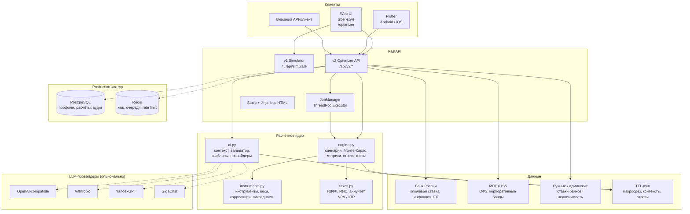
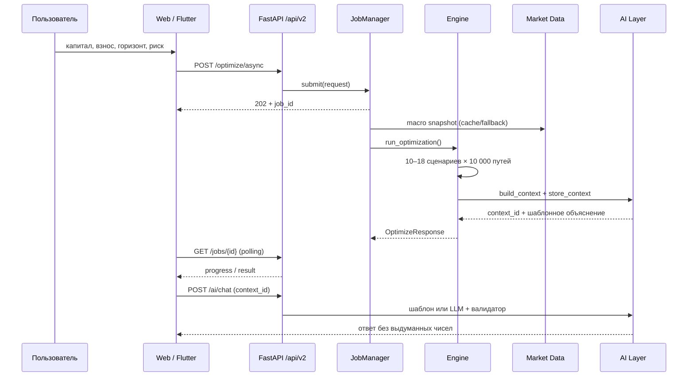

# Оптимизатор капитала «ФинХелл» — техническая документация v2

Документ описывает вторую версию продукта: оптимизатор капитала для России
с тремя уровнями риска, 10 000+ сценариев Монте-Карло, стресс-тестами,
сравнениями «аренда vs покупка» и «досрочное погашение vs инвестирование»,
AI-объяснениями и Sber-style интерфейсом.

Первая версия — пошаговый симулятор в `DefultCredit/simulator.py` — сохранена
без изменений и доступна на `/`. Вторая версия живёт в `DefultCredit/optimizer/`
и монтируется в то же FastAPI-приложение по префиксу `/api/v2`.

---

## 1. Что уже работает

| Блок | Статус | Где |
|---|---|---|
| v1-симулятор, облигации, Монте-Карло | работает | `simulator_engine.py`, `simulator_plan.py`, `templates/simulator.html` |
| Каталог инструментов РФ | работает | `optimizer/instruments.py` |
| Макросрез ЦБ РФ / MOEX ISS + fallback | работает | `optimizer/market_data.py` |
| 10–18 сценариев, три уровня риска | работает | `optimizer/instruments.py`, `optimizer/engine.py` |
| 10 000 путей Монте-Карло на сценарий | работает | `optimizer/engine.py` |
| Налоги, ИИС, НДФЛ, NPV/IRR | работает | `optimizer/taxes.py` |
| Стресс-тесты | работает | `optimizer/engine.py` |
| AI-объяснения и чат | работает в шаблонном режиме; LLM — опционально | `optimizer/ai.py` |
| Фоновые задания | работает | `optimizer/jobs.py` |
| Sber-style веб-интерфейс | работает | `templates/optimizer.html`, `static/optimizer.css`, `static/optimizer.js` |
| Flutter-каркас | форма, результаты, графики, AI-чат; не собран без Flutter SDK | `mobile/` |
| Тесты | 61 тест, все проходят | `DefultCredit/tests/` |

### Осознанные ограничения текущего стенда

- Алгоритмы и кэш написаны на чистом Python: в окружении нет
  `numpy/scipy/pandas/redis/httpx`. Это не мешает логике, но 10 000 путей
  считаются дольше, чем на NumPy.
- LLM-провайдеры реализованы, но без ключей проверен только шаблонный режим.
- Flutter-клиент не собирался: в среде нет Flutter/Dart SDK.
- Живые данные ЦБ/MOEX запрашиваются только при `refresh=true`; по умолчанию
  используется кэш или демо-срез, чтобы интерфейс не зависел от доступности
  внешних сайтов.

---

## 2. Архитектура



### Поток расчёта



---

## 3. Входные данные

### Профиль пользователя

| Поле | Тип | По умолчанию | Смысл |
|---|---|---|---|
| `capital` | ₽ | 500 000 | текущий капитал |
| `monthly` | ₽/мес | 20 000 | ежемесячный взнос |
| `horizon_months` | мес | 60 | горизонт 1–600 |
| `risk_tolerance` | enum | `moderate` | `conservative / moderate / aggressive` |
| `liquidity_need` | enum | `medium` | `high / medium / low` |
| `credit_willingness` | bool | false | готовность к плечу |
| `credit_type` | enum | `none` | `none / consumer / mortgage` |
| `goal_amount` | ₽? | null | цель по капиталу |
| `monthly_expenses` | ₽ | 50 000 | расходы для резерва |
| `emergency_fund_months` | мес | 6 | размер резерва |
| `existing_mortgage` | объект? | null | остаток, ставка, платёж, срок, залог |
| `iis` | объект? | null | тип A/B, взнос, годы |
| `deposits` | список | [] | существующие вклады |
| `region` | строка | Москва | регион |

### Макропараметры

Каждое значение — `DataPoint` с полями `value`, `unit`, `source`,
`updated_at`, `is_fallback`, `note`. Это требование «источник и время у каждой
цифры» выполнено на уровне модели, а не только UI.

| Ключ | Демо-значение | Источник |
|---|---:|---|
| `key_rate` | 16,0% | Банк России |
| `inflation_yoy` | 8,5% | Банк России |
| `inflation_expected` | 6,0% | Банк России / прогноз |
| `deposit_rate` | 15,0% | агрегатор банковских ставок |
| `savings_rate` | 14,0% | агрегатор |
| `credit_rate` | 24,0% | агрегатор |
| `mortgage_rate` | 20,0% | агрегатор |
| `ofz_yield_10y` | 13,5% | MOEX ISS |
| `corporate_yield` | 16,5% | MOEX ISS |
| `municipal_yield` | 14,5% | MOEX ISS / ручной ввод |
| `real_estate_growth` | 8,0% | админ-панель |
| `rent_yield` | 5,0% | админ-панель |
| `usd_rub`, `eur_rub` | 90 / 100 | Банк России |
| `ofz_curve` | 1–120 мес | MOEX / демо-кривая |

Любое поле можно переопределить через `market_overrides`; в UI для этого есть
блок «Макропараметры и ручные данные». Пустое поле означает «взять из
источника».

### Кэш и fallback

- `refresh=false` — мгновенный ответ из TTL-кэша или демо-срез.
- `refresh=true` — параллельные запросы к ЦБ РФ и MOEX ISS с коротким таймаутом.
- Если источник недоступен, соответствующая точка остаётся `is_fallback=true`,
  а в `data_sources` появляется статус `fallback` и пояснение.
- Ручные значения помечаются статусом `manual` и имеют приоритет над live.

---

## 4. Инструменты и сценарии

### Разрешённые классы активов

| Ключ | Инструмент | Доходность | Волатильность | Ликвидность | Налог |
|---|---|---:|---:|---:|---|
| `cash` | денежный резерв | ключевая − 2 п.п. | 0,5% | 100% | проценты |
| `savings` | накопительный счёт | ставка счёта | 0,5% | 100% | проценты |
| `deposit` | банковский вклад | ставка вклада | 0,5% | 95% | проценты |
| `ofz_short` | короткие ОФЗ | 0,85 × ОФЗ 10л | 4% | 90% | купон |
| `ofz_long` | длинные ОФЗ | ОФЗ 10л + премия | 11% | 70% | купон |
| `corporate` | корпоративные облигации | корпоративная + премия | 13% | 60% | купон |
| `municipal` | муниципальные облигации | муниципальная + премия | 9% | 65% | купон |
| `real_estate` | арендная недвижимость | аренда + рост − 2 п.п. | 14% | 20% | аренда |

Акции, криптовалюта, форекс и прочие инструменты вне модели исключены
на уровне каталога и системного промпта AI.

### Генерация сценариев

`scenario_templates()` создаёт 10–18 сценариев:

1. Базовые шаблоны для трёх уровней риска.
2. Проверка доступности: минимальная сумма инструмента и стартовый капитал
   (для недвижимости — порог входа; при малом капитале, но регулярных взносах
   учитывается `monthly × 3`).
3. Проверка ликвидности: для `high` минимум 30% в ликвидных активах,
   для `medium` — 15%, для `low` — 5%. Недостающая доля забирается у самого
   неликвидного актива и переносится во вклад.
4. Ипотечные сценарии добавляются только при `credit_willingness=true` и
   `credit_type=mortgage`.
5. Флаги `include_real_estate` и `include_mortgage` фильтруют готовый список.
6. Если сценариев меньше `max_scenarios`, добавляются нейтральные комбинации;
   при этом все три уровня риска сохраняются.

### Ожидаемая доходность и риск портфеля

Доходность портфеля:

```text
E[R] = Σ w_i × μ_i
```

Волатильность считается через ковариационную матрицу, восстановленную из
трёх бет инструмента (рынок, ставка, инфляция) и идиосинкратического шума:

```text
cov(i,j) = β_market_i × β_market_j
         + 0.4 × β_rate_i × β_rate_j
         + 0.3 × β_inflation_i × β_inflation_j
σ_p = sqrt(Σ_i Σ_j w_i × w_j × cov(i,j))
```

Это упрощённый mean-variance / Black-Litterman-эквивалент: рыночные
ожидания задаются макросрезом, а не историческими доходностями. Для MVP
этого достаточно; в production-контуре матрицу можно заменить на
`numpy`/`scipy`-оптимизацию с ограничениями.

### Монте-Карло

Для каждого сценария:

- 10 000 путей по умолчанию (100–50 000).
- Горизонт — месяцы, взнос добавляется каждый месяц.
- Распределения:
  - `normal` — системный и идиосинкратический нормальный шок;
  - `student_t` — тяжёлые хвосты через χ²-масштабирование;
  - `historical` — выборка из 120 синтетических исторических месячных
    доходностей, построенных вокруг текущего макросреза.
- Налоги и комиссии вычитаются из доходности каждого инструмента по типу
  дохода (проценты / купон / аренда), а не «размазываются» по портфелю.
- Для ипотечных сценариев учитывается плечо, ставка и остаток долга.
- Зерно генератора детерминировано: `zlib.crc32(scenario_id)` + `seed`,
  поэтому одинаковый запрос даёт одинаковый результат независимо от
  `PYTHONHASHSEED`.

### Метрики

| Метрика | Формула / смысл |
|---|---|
| Номинальная доходность | `E[R]` портфеля |
| Реальная доходность | `(1 + E[R]) / (1 + инфляция) − 1` |
| Доходность после налогов | `E[R] − tax_drag − fee_drag` |
| YTM / дюрация | средневзвешенные по облигационным активам |
| Волатильность | `σ_p` |
| VaR 95 | 5-й перцентиль месячных/годовых потерь |
| CVaR 95 | среднее потерь хуже VaR |
| Максимальная просадка | медиана и P90 по путям |
| Sharpe | `(E[R] − risk_free) / σ_p` |
| Sortino | `(E[R] − risk_free) / downside deviation` |
| Вероятность цели | доля путей с капиталом ≥ цели |
| Вероятность убытка | доля путей с капиталом ниже взносов |
| P5/P25/P50/P75/P95 | перцентили терминального капитала |
| Гистограмма | 20 корзин терминального капитала |
| NPV | дисконтированные денежные потоки по ключевой ставке |
| IRR | годовая внутренняя норма доходности |
| Налоги | годовой НДФЛ, суммарно за горизонт, эффективная ставка |
| Комиссии | годовые и суммарные, эффективная ставка |

### Ранжирование

Внутри каждого уровня риска все метрики нормализуются в [0, 1], затем
считается score:

```text
score = 0.30 × Sharpe_norm
      + 0.25 × NPV_norm
      + 0.15 × GoalProbability_norm
      + 0.15 × StressResilience_norm
      + 0.10 × Liquidity_norm
      − 0.10 × Drawdown_norm
```

`StressResilience` — `1 + min(impact_p50)` по всем стресс-тестам: чем меньше
худший удар, тем выше устойчивость. Score ограничен [0, 1]. Топ-10 строится
по всем уровням риска, но внутри карточек каждый уровень показывает своего
лидера — так пользователь видит три честных компромисса, а не один
«универсальный» ответ.

### Стресс-тесты

Для каждого сценария считаются 10 детерминированных шоков:

- ключевая ставка +100 / +300 / +500 б.п.;
- ключевая ставка −100 / −300 / −500 б.п.;
- инфляция +3 п.п.;
- налоговый режим +2 п.п.;
- недвижимость −20%;
- ипотечная ставка +3 п.п.

Для каждого шока возвращаются `impact_p50`, `impact_p5`, `terminal_p50` и
пояснение. Длительность облигаций усиливает чувствительность к ставке,
плечо — к ипотечной ставке.

---

## 5. AI-слой

### Принцип

LLM **не считает**. Расчётный движок формирует детерминированный JSON-контекст;
модель может только объяснять его. Любое число в ответе проверяется
валидатором: если модель придумала цифру, ответ заменяется шаблонным.

### Схема контекста

```json
{
  "meta": {"generated_at": "...", "request_id": "...", "currency": "RUB", "disclaimer": "..."},
  "profile": {
    "capital": 500000, "monthly": 20000, "horizon_months": 60,
    "horizon_years": 5, "risk_tolerance": "moderate", "liquidity_need": "medium",
    "goal_amount": 1500000, "emergency_fund_target": 300000,
    "iis_type": "A", "existing_mortgage_balance": 0, "deposits_total": 0
  },
  "macro": {
    "key_rate": {"value": 0.16, "source": "Банк России / демо", "updated_at": "...", "is_fallback": true},
    "inflation_expected": {"value": 0.06, "...": "..."},
    "ofz_curve": [{"tenor_months": 12, "yield_rate": 0.14}],
    "data_sources": [{"key": "cbr", "status": "fallback", "...": "..."}]
  },
  "risk_profiles": {
    "low": {"label": "Низкий риск", "options": [{"id": "...", "monte_carlo": {"terminal_p5": 0, "terminal_p50": 0, "terminal_p95": 0}, "taxes": {}, "stress_tests": []}]},
    "medium": {"...": "..."},
    "high": {"...": "..."}
  },
  "top_options": [],
  "comparisons": {},
  "warnings": []
}
```

Контекст сжимается: в него попадают только числа и поля, которые нужны для
объяснения. Это снижает расход токенов и риск галлюцинаций.

### Системный промпт

Промпт требует:

1. Использовать только числа из JSON-контекста.
2. Не выполнять арифметику и не экстраполировать.
3. Не гарантировать доходность и не писать «без риска», «точно», «100%».
4. Не предлагать акции, криптовалюту и инструменты вне модели.
5. Не смешивать три уровня риска.
6. Писать по-русски, кратко и структурированно.
7. Всегда напоминать, что это не индивидуальная инвестиционная рекомендация.
8. В режиме объяснения возвращать строгий JSON, в режиме чата — обычный текст.

### Валидатор чисел

- Извлекает числа, проценты, суммы, единицы «тыс./млн/млрд».
- Собирает допустимое множество из контекста: сами значения, проценты,
  структурные числа (годы, месяцы, 100%).
- Для сумм ≥ 1000 и процентов проверяет допуск 1% или 0,51.
- Игнорирует годы 1900–2100 и мелкие структурные числа.
- При нарушении возвращает шаблонное объяснение с пометкой
  `template:validator_fallback`.

### Провайдеры

| Провайдер | Переменные | Особенности |
|---|---|---|
| OpenAI-compatible | `LLM_PROVIDER=openai`, `LLM_API_KEY`, `LLM_BASE_URL`, `LLM_MODEL` | подходит для OpenAI, OpenRouter, локального vLLM |
| Anthropic | `LLM_PROVIDER=anthropic`, `LLM_API_KEY` | `/v1/messages` |
| YandexGPT | `LLM_PROVIDER=yandex`, `YANDEX_API_KEY`, `YANDEX_FOLDER_ID` | `gpt://folder/model` |
| GigaChat | `LLM_PROVIDER=gigachat`, `GIGACHAT_API_KEY` | OAuth + `/chat/completions` |
| Шаблон | без ключей | полностью автономный fallback |

Общие переменные: `LLM_TIMEOUT`, `LLM_MAX_TOKENS`, `LLM_MODEL`.

### Кэш и стриминг

- Контекст хранится 30 минут, ответ — 10 минут.
- Ключ ответа — SHA-256 от `context_id + provider + model + question + history`.
- SSE-эндпоинты отдают события `start → token* → result → done` (или `error`).
- В production контексты и ответы лучше перенести в Redis с тем же TTL.

### Модерация

- Блокируются запросы про обнал, уход от налогов, гарантированную доходность,
  инсайд и взлом.
- Ответы проходят проверку на пустоту и числа.
- Дисклеймер добавляется всегда.

---

## 6. Модуль трёх уровней риска

| Уровень | Состав | Ожидаемый профиль | Ликвидность |
|---|---|---|---|
| Низкий | вклады, накопительный счёт, короткие ОФЗ, муниципальные | 13–15%, малая просадка | 90–100% |
| Средний | длинные ОФЗ, корпоративные и муниципальные облигации, недвижимость | 14–16%, умеренная дюрация | 60–85% |
| Высокий | длинная дюрация, кредитный риск, ипотечное плечо | 15–17%+, широкая P5–P95 | 20–70% |

Для каждого уровня возвращаются:

- состав портфеля с весами и суммами;
- номинальная, реальная и посленалоговая доходность;
- волатильность, VaR95, CVaR95, максимальная просадка;
- P5/P50/P95 и вероятность цели;
- ликвидность и её текстовый ярлык;
- налоги, комиссии, дюрация;
- стресс-тесты;
- объяснение «почему этот сценарий».

Три карточки строятся параллельно на одних и тех же макроданных и горизонте,
поэтому их можно честно сравнивать.

---

## 7. Интерфейс

### Визуальный язык

- Зелёный `#21A038` / `#37C455`, белый, почти чёрный `#0A0F0B`.
- Крупные скругления: карточки 24–32 px, кнопки 16 px.
- Мягкие тени, полупрозрачные слои, градиентный hero-блок.
- Светлая и тёмная темы, выбор сохраняется в `localStorage`.
- Адаптивность: 1560 px → 1100 px → 720 px.
- Никакого «финтех-шума»: один акцентный цвет, понятные подписи, крупные цифры.

### Структура экрана результатов

```text
┌──────────────────────────────────────────────────────────────────────┐
│ ФинХелл · Оптимизатор капитала        Симулятор v1   API   [тема]   │
├──────────────────────────────────────────────────────────────────────┤
│ Hero: «Оптимизатор капитала» + 10 000 путей + стресс-тесты + AI      │
├───────────────────┬──────────────────────────────────────────────────┤
│ Форма (sticky)    │ Лучший сценарий: доходность, P50, цель, просадка │
│ • капитал         │ Макросрез: ставка, инфляция, вклады, ипотека     │
│ • взнос, горизонт ├──────────────────────────────────────────────────┤
│ • риск, ликвидн.  │ Три карточки: Низкий / Средний / Высокий         │
│ • кредит, ИИС     │ состав, доходность, P5/P50/P95, ликвидность      │
│ • макро, опции    ├──────────────────────────────────────────────────┤
│ [Рассчитать]      │ Коридор капитала P5–P95 │ Гистограмма P5/P50/P95 │
│                   ├──────────────────────────────────────────────────┤
│                   │ Топ-10 сценариев: риск, доходность, Sharpe       │
│                   ├──────────────────────────────────────────────────┤
│                   │ Стресс-тесты: шок → влияние на P50/P5            │
│                   ├──────────────────────────────────────────────────┤
│                   │ Аренда vs покупка │ Досрочно vs инвестировать   │
│                   ├──────────────────────────────────────────────────┤
│                   │ AI-объяснение     │ Чат по расчёту               │
└───────────────────┴──────────────────────────────────────────────────┘
```

### Компоненты

- **Risk card** — цветная полоса уровня, score-ring, состав, метрики,
  диапазон P5–P95, кнопка «Все сценарии».
- **Fan chart** — коридор P5–P95, медиана P50, пунктир взносов, подпись
  конечного капитала. Ось X — годы, а не произвольные четверти.
- **Histogram** — 20 корзин, красная зона ниже P5, маркеры P5/P50/P95.
- **Top table** — кликабельные строки, модалка с составом, налогами,
  стресс-тестами и объяснением.
- **Stress selector** — переключение сценария, таблица шоков.
- **AI panel** — summary, три чипа риска, шаги, «почему так», риски.
- **Chat** — подсказки, история, индикатор набора, ограничение длины.
- **Toast** — ошибки и статусы, не блокирует интерфейс.

---

## 8. Мобильный клиент

Каркас Flutter лежит в `mobile/` и повторяет Sber-style веб-интерфейс:

- `lib/screens/home_screen.dart` — форма капитала, взноса, цели, риска,
  ликвидности, кредита, расходов и параметров расчёта;
- `lib/screens/results_screen.dart` — hero лучшего сценария, макроданные,
  три карточки риска, веер P5–P95, гистограмма, топ сценариев, стресс-тесты,
  AI-объяснение и чат;
- `lib/widgets/fan_chart.dart`, `histogram_chart.dart` — графики на `fl_chart`;
- `lib/widgets/risk_card.dart` — карточка уровня риска и мини-состав портфеля;
- `lib/widgets/ai_chat.dart` — чат по `context_id` с историей;
- `lib/services/api_client.dart` — асинхронный расчёт и polling заданий;
- `lib/theme/sber_theme.dart` — светлая и тёмная темы.

Запуск:

```powershell
cd mobile
flutter pub get
flutter run --dart-define=API_BASE_URL=http://10.0.2.2:8002
```

`10.0.2.2` — хост-машина для Android-эмулятора; для iOS-симулятора
используйте `127.0.0.1`, для физического устройства — LAN-адрес. Подробности
в `mobile/README.md`.

Каркас требует Flutter 3.27+ и в текущем окружении не собирался: Flutter/Dart
SDK не установлен. Это ограничение среды, а не архитектуры.

---

## 9. API

Базовый URL локального стенда: `http://127.0.0.1:8002`.

### Health

```bash
curl http://127.0.0.1:8002/api/v2/health
```

### Макросрез

```bash
curl http://127.0.0.1:8002/api/v2/macro
curl "http://127.0.0.1:8002/api/v2/macro?refresh=true"
```

### Синхронный расчёт

```bash
curl -X POST http://127.0.0.1:8002/api/v2/optimize \
  -H "Content-Type: application/json" \
  -d '{
    "profile": {
      "capital": 500000,
      "monthly": 20000,
      "horizon_months": 60,
      "risk_tolerance": "moderate",
      "liquidity_need": "medium",
      "goal_amount": 1500000,
      "monthly_expenses": 50000,
      "emergency_fund_months": 6
    },
    "options": {
      "monte_carlo_paths": 1000,
      "max_scenarios": 10,
      "distribution": "normal",
      "seed": 42
    }
  }'
```

Ограничение синхронного режима — 3000 путей. Выше — HTTP 413.

### Асинхронный расчёт

```bash
curl -X POST http://127.0.0.1:8002/api/v2/optimize/async \
  -H "Content-Type: application/json" \
  -d '{"profile": {"capital": 500000, "monthly": 20000, "horizon_months": 60},
       "options": {"monte_carlo_paths": 10000, "max_scenarios": 10}}'
```

Ответ:

```json
{"job_id": "...", "status": "queued", "poll_url": "/api/v2/jobs/...", "estimated_seconds": 17}
```

Статус:

```bash
curl http://127.0.0.1:8002/api/v2/jobs/<job_id>
```

### AI

```bash
curl -X POST http://127.0.0.1:8002/api/v2/ai/explain \
  -H "Content-Type: application/json" \
  -d '{"context_id": "ctx_...", "use_llm": false}'
```

```bash
curl -X POST http://127.0.0.1:8002/api/v2/ai/chat \
  -H "Content-Type: application/json" \
  -d '{"context_id": "ctx_...", "question": "Какие риски при высокой ставке?", "use_llm": false}'
```

SSE:

```bash
curl -N -X POST http://127.0.0.1:8002/api/v2/ai/chat/stream \
  -H "Content-Type: application/json" \
  -d '{"context_id": "ctx_...", "question": "Что лучше: вклад или ОФЗ?"}'
```

### Сравнения

```bash
curl -X POST http://127.0.0.1:8002/api/v2/compare/rent-vs-buy \
  -H "Content-Type: application/json" \
  -d '{"capital": 1000000, "property_value": 6000000, "mortgage_rate": 0.2,
       "horizon_months": 60, "rent_yield": 0.05, "real_estate_growth": 0.08,
       "investment_return": 0.15, "discount_rate": 0.16}'
```

```bash
curl -X POST http://127.0.0.1:8002/api/v2/compare/prepay-vs-invest \
  -H "Content-Type: application/json" \
  -d '{"balance": 1000000, "annual_rate": 0.2, "capital": 500000,
       "horizon_months": 60, "investment_return": 0.15}'
```

---

## 10. Производительность и тесты

### Замеры на текущем стенде

| Режим | Пути | Сценарии | Время |
|---|---:|---:|---:|
| Синхронный | 150 | 10 | ~0,35 с |
| Асинхронный | 1 000 | 10 | ~3 с |
| Асинхронный | 10 000 | 10 | ~20 с |

10 000 × 60 месяцев × 10 сценариев — это около 6 млн месячных шагов; на
чистом Python быстрее не получится. В production ядро нужно переносить на
NumPy/SciPy или векторизовать по путям.

### Тесты

```powershell
.\myvenv\Scripts\python.exe -m unittest discover -s DefultCredit/tests -v
```

Покрыто:

- налоги, вычеты, аннуитет, остаток долга, NPV/IRR;
- каталог активов, генерация сценариев, ликвидность, доступность, ипотека;
- порядок перцентилей, детерминизм, все распределения, стресс-тесты;
- структура ответа, ранжирование, фильтры недвижимости и ипотеки;
- AI-контекст, валидатор, шаблоны, чат, модерация;
- парсер MOEX ISS и макросрез;
- 22 теста v1-симулятора.

Итог: **61 тест, все проходят** (~6 секунд).

---

## 11. Production-развёртывание

### Компоненты

- FastAPI + Uvicorn/Gunicorn.
- PostgreSQL — профили, расчёты, аудит, версии макросреза.
- Redis — кэш макросреза/контекстов/ответов, очередь тяжёлых задач,
  rate limit.
- Celery/RQ или собственный JobManager на Redis — фоновые 10k-расчёты.
- S3-совместимое хранилище — отчёты PDF/Excel.
- Prometheus + Grafana + Sentry — метрики и ошибки.

### Переменные окружения

```env
OPTIMIZER_JOB_WORKERS=2
LLM_PROVIDER=
LLM_API_KEY=
LLM_BASE_URL=
LLM_MODEL=
LLM_TIMEOUT=25
LLM_MAX_TOKENS=1200
REDIS_URL=redis://localhost:6379/0
DATABASE_URL=postgresql+asyncpg://...
```

### Безопасность

- Не логировать полные профили и суммы; маскировать персональные данные.
- Ограничить CORS доверенными доменами.
- Rate limit на `/api/v2/ai/*` и `/optimize/async`.
- Валидация Pydantic на всех входах, `extra="forbid"`.
- LLM получает только сжатый контекст без имени, телефона, email и точного
  адреса.
- Дисклеймер и модерация — обязательные элементы, а не «настройка».
- Для финансовых рекомендаций в РФ учитывать требования 39-ФЗ и
  маркировку рекламы; в MVP продукт позиционируется как расчётный
  симулятор, а не индивидуальная инвестиционная рекомендация.

### Наблюдаемость

- Метрики: p50/p95 времени расчёта, доля fallback-данных, доля
  validator_fallback, ошибки провайдеров, размер очереди.
- Аудит: `request_id`, версия модели, `context_id`, источник данных,
  `generated_by`.
- Алерты: рост 5xx, деградация ЦБ/MOEX, превышение времени job > 120 с.

---

## 12. Рекомендации по API и библиотекам РФ

### Данные

| Задача | Источник / библиотека | Комментарий |
|---|---|---|
| Ключевая ставка, инфляция, FX | ЦБ РФ (`cbr.ru`) | XML/HTML, нужен кэш и fallback |
| ОФЗ, корпоративные, муниципальные бонды | MOEX ISS (`iss.moex.com`) | `securities` + `marketdata`, boards TQOB/TQCB |
| Кривая бескупонной доходности | ЦБ РФ / MOEX | для YTM и дюрации |
| Ставки по вкладам | агрегаторы (Banki.ru, Sravni.ru), сайты банков | юридические ограничения на парсинг; лучше договор/ручной ввод |
| Ипотека | ДомКлик, сайты банков | ручной/админский ввод в MVP |
| Недвижимость | ДомКлик, Циан, Росреестр | цены и аренда; в MVP — ручной ввод |
| Статистика | Росстат | инфляция, доходы, рынок труда |
| LLM | YandexGPT, GigaChat | российские провайдеры, локальные данные |
| LLM (опционально) | OpenAI, Anthropic, OpenRouter | через provider abstraction |

### Python

- `numpy`, `scipy` — векторизованное Монте-Карло, оптимизация портфеля.
- `pandas` — временные ряды и агрегаты.
- `httpx` — асинхронные запросы к ЦБ/MOEX/LLM.
- `redis` — кэш и очередь.
- `SQLAlchemy` + `Alembic` — PostgreSQL.
- `pydantic-settings` — конфигурация.
- `pytest` + `pytest-asyncio` — тесты.
- `tenacity` — retry с backoff для внешних API.
- `orjson` — быстрый JSON.

### Flutter

- `dio` — HTTP-клиент.
- `fl_chart` — графики.
- `flutter_riverpod` — состояние.
- `go_router` — навигация.
- `intl` — форматирование рублей и дат.
- `flutter_secure_storage` — токены.
- `freezed` + `json_serializable` — модели.
- `sse_channel` / собственный SSE-клиент — стриминг AI.

---

## 13. Roadmap

### MVP (текущий)

- [x] Три уровня риска.
- [x] 10–18 сценариев, 10 000 путей.
- [x] Вклады, ОФЗ, корпоративные и муниципальные бонды, недвижимость, ипотека.
- [x] Налоги, ИИС, NPV/IRR.
- [x] Стресс-тесты.
- [x] AI-объяснение и чат с валидатором.
- [x] Sber-style web UI.
- [x] Тесты и документация.
- [x] Flutter-каркас.

### Ближайшее расширение

- [ ] Перенос ядра на NumPy/SciPy и векторизация по путям.
- [ ] PostgreSQL + Redis + Celery/RQ.
- [ ] Аутентификация, профили, история расчётов.
- [ ] PDF/Excel-отчёт.
- [ ] Подключение реальных ключей LLM и A/B-сравнение провайдеров.
- [ ] Больше данных: кривая ЦБ, реальные купоны и дюрации MOEX, ставки банков.
- [ ] Сценарии с несколькими целями и временными этапами.
- [ ] Учёт льготной ипотеки, семейной ипотеки, налоговых лимитов по годам.
- [ ] Push-уведомления о пересчёте при изменении ключевой ставки.

### Дальше

- [ ] Black-Litterman с рыночными ожиданиями и взглядами пользователя.
- [ ] Оптимизация с ограничениями (ликвидность, дюрация, кредитный риск).
- [ ] Персональные рекомендации с объяснимым трейд-оффом.
- [ ] Мобильные приложения Android/iOS на Flutter.
- [ ] Интеграция с брокерскими и банковскими API (осторожно, с лицензиями).
- [ ] Мультиязычность и мультивалютность.
- [ ] Партнёрские предложения банков и брокеров с прозрачной маркировкой.

---

## 14. Ограничения и дисклеймер

- Модель использует демо-макросрез, если live-источники недоступны.
- Ожидаемые доходности — не прогноз, а сценарные допущения.
- Налоги упрощены: не учитываются все жизненные ситуации, льготы и
  региональные особенности.
- Недвижимость и ипотека моделируются укрупнённо: без ремонта, простоев,
  страховки, налогов на имущество и комиссий сделки.
- Monte Carlo на чистом Python медленнее, чем на NumPy.
- LLM без ключей работает в шаблонном режиме; качество живых ответов
  зависит от провайдера и промпта.
- Это не индивидуальная инвестиционная рекомендация. Проверяйте условия
  у банка, брокера и налогового консультанта.
